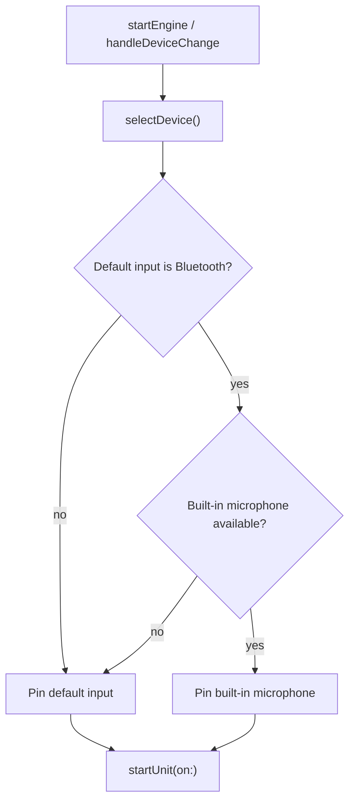

# 0003 — a new capture path, drawn as a diagram

**Claim.** When a change moves structure, here the path audio takes from a device into a recording, the body ends its Summary with one Mermaid diagram labelled with names from the diff, and leads with the problem the change solves.

**Input.** The same macOS app as 0001. Five commits, twenty files, 542 insertions and 177 deletions: microphone capture moves from `AVAudioEngine` to a HAL output unit pinned to one chosen input device, with two new source files, a rewritten `MicrophoneCapability.swift`, three other sources, three test files, the changelog, `AGENTS.md`, and nine docs. With a Bluetooth headset as the default input, River now records from the built-in microphone, so the headset stays out of call mode.

## bare

Read the repo's `docs/conventions/git.md`, `git diff --stat`, and the five commit messages; never read the diff. Its first `cat > /tmp/pr76.md` needed approval outside the clone and was refused, so it passed the body inline. Pushed with `git push -u`, then `gh pr create`. 7 turns, 27.1 s, $0.115.

**Title:** `feat(audio): capture through a HAL unit pinned to the chosen device`

```markdown
## Summary
Microphone capture moves from `AVAudioEngine` to a HAL output unit pinned to one chosen input device, so a Bluetooth headset no longer drops into call mode when recording starts.

## Scope
- `MicrophoneCapability`, plus new `CoreAudioDevices` and `InputDeviceSelection` in `Sources/River/Architecture/`
- `AudioCaptureManager`, `Constants`, `AppState`
- Tests: capability, device selection, render buffer, capture manager
- Docs: capability/permissions/pipeline docs, ADR 0001, plan 0032, logging and tests conventions, AGENTS.md rule 3, CHANGELOG

## Changes Made
- `MicrophoneCapability` opens a HAL output unit pinned to one device before it initialises. `AudioOutputUnitStart` replaces `AVAudioEngine`, and it is still called in only that one place.
- `InputDeviceSelection` picks the built-in microphone (preferring the `BuiltInMicrophoneDevice` UID) when the default input is Bluetooth.
- HAL listeners for the default input and the device list replace the configuration-change notification. The unit restarts only on a new device, or on the same device at a new nominal rate.
- `renderBuffer` sets `frameLength` before `AudioUnitRender`. Without it every render failed with paramErr and recordings came back empty.
- The render callback logs its first failure per unit. Listener removal logs a non-zero status, and device names log as private.
- Docs and wording no longer refer to an audio engine.

## Impact
- The capture path changes for all users. The permission gate and the single `AudioOutputUnitStart` call site are unchanged.
- Bluetooth default inputs now record from the built-in mic, so the headset stays in high-quality output mode.
- Rule 3 and the audio docs are updated in the same change.

## Testing
- [ ] `swift build`
- [ ] `swift test`
- [ ] On device: record with the built-in mic as default input
- [ ] On device: record with a Bluetooth headset as default input (no call-mode switch, non-empty transcript)
- [ ] On device: change the default input and the device sample rate mid-session

🤖 Generated with [Claude Code](https://claude.com/claude-code)
```

## skill

Preflight, then the merge-base diff in two calls by path, as the preflight's "read path by path" note asks for a diff over 500 lines: the sources, changelog, `AGENTS.md`, and tests, then the app, manager, utility, and selection files with the first 250 changed lines of `MicrophoneCapability.swift`. Then one call that wrote the body and the title to `mktemp` files and ran the `ship:` command; the lint passed first time, and the gate pushed and opened the PR. 5 turns, 26.1 s, $0.153.

**Title:** `feat(audio): capture through a HAL unit pinned to the chosen device`

````markdown
## Summary

Recording with AirPods or another Bluetooth headset as the default input switched the headset into call mode (HFP), which cut everything the Mac played to 8–24 kHz and ended the first recording early. `MicrophoneCapability` now captures through a HAL output unit pinned to one device before it initialises. When the default input is Bluetooth and the Mac has a built-in microphone, the unit pins to the built-in microphone, so the headset stays in 48 kHz A2DP.



## Changes

- `MicrophoneCapability` replaces `AVAudioEngine` with a HAL capture unit that enables input, pins the device, sets the client format, then initialises.
- `MicrophoneCapability.handleDeviceChange` replaces `handleConfigurationChange`. It listens to the default input, the device list, and the pinned device's sample rate and liveness, and restarts the unit only when the chosen device or its rate changes.
- `InputDeviceSelection` (new) holds the pure rule that picks the built-in microphone over a Bluetooth default.
- `CoreAudioDevices` (new) wraps the HAL queries: default input, built-in input, Bluetooth transport, name, and nominal sample rate.
- `AudioCaptureManager`, `AppState`, and `Constants` comments and the `noAudioCaptured` message name the capture unit instead of the engine.
- `AGENTS.md` rule 3 names `AudioOutputUnitStart` as the one microphone OS call, and the architecture, logging, test, and planning docs follow.
- `CapabilityTests`, `AudioCaptureManagerTests`, and `InputDeviceSelectionTests` cover the new selection rule and the device-change handler.
- `CHANGELOG.md` records the built-in microphone choice and the reworded device-change fix.

## Impact

- With a Bluetooth headset as the default input, River records from the built-in microphone, not the headset's. A Mac without a built-in microphone keeps using the headset.
- The capture unit's start-up latency is not yet measured. `AudioCaptureManager.warmupWaitSeconds` and the capture-gap constants keep the values measured under `AVAudioEngine`.

## Testing

For the reviewer:
- [ ] Run `swift test` and confirm all suites pass
- [ ] Connect AirPods, record a dictation, and confirm the text arrives and the AirPods stay in high-quality playback
- [ ] Unplug a USB microphone mid-recording and confirm the recording continues
- [ ] Record on a Mac with only a Bluetooth input and confirm the headset records
````

Its reply on the diagram: "I included a flowchart of how `selectDevice()` picks the capture device. The change replaces `AVAudioEngine` with a HAL unit and adds device-selection logic, and the reviewer would otherwise have to rebuild that flow from the diff."

## Observations

- Same title from both arms, the lead commit's subject.
- The skill drew the diagram, so the claim holds in this run: a flowchart of how `selectDevice()` picks the device, from its two callers through the Bluetooth and built-in checks to `startUnit(on:)`, seven nodes at the end of `## Summary`, which passed the lint's shape checks. Batch 5's run of this case drew none. Each probe drew it in 2 of 3 runs, so the rule holds on most runs of this case, not on every one (see History).
- Bare never opened the diff; its bullets restate the five commit messages. The skill read the diff by path, and its Summary carries what only the diff's comments hold: call mode (HFP) cut everything the Mac played to 8–24 kHz and ended the first recording early, and the headset now stays in 48 kHz A2DP.
- The Summary leads with that problem, as someone using AirPods met it, then says what `MicrophoneCapability` does now. Bare's Summary opens on the change.
- The skill's Impact names the outcome a user would notice, recording from the built-in microphone, the case that keeps the old behavior, a Mac without one, and the risk the diff's comments admit: the unit's start-up latency is unmeasured, and the warm-up and capture-gap constants keep their `AVAudioEngine` values. Bare's Impact has neither.
- Each of the skill's reviewer boxes opens on its verb and names what to confirm. The third, "Unplug a USB microphone mid-recording and confirm the recording continues", is the example `SKILL.md` now gives for a reviewer box, written from the box a probe run of this case was warned on ("Unplugging a USB microphone…"). So this run shows the form holds on the case the example came from; the boxes in 0001, 0002, 0004, and 0005 open on a verb as well.
- Bare followed the repo's skeleton with `## Scope`, and ended with the harness footer. The skill's body has neither.
- The skill cost $0.153 against bare's $0.115, and took 26 s against 27 s. The diff is the largest of these cases, about 720 changed lines.
