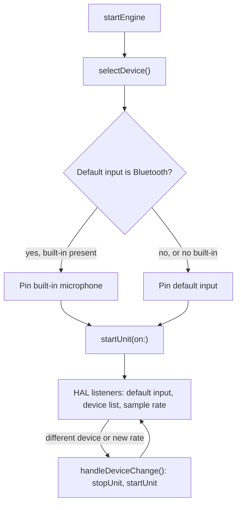

# 0003 — a new capture path, drawn as a diagram

**Claim.** When a change moves structure, here the path audio takes from a device into a recording, the body ends its Summary with one Mermaid diagram labelled with names from the diff, and leads with the problem the change solves.

**Input.** The same macOS app as 0001. Five commits, twenty files, 542 insertions and 177 deletions: microphone capture moves from `AVAudioEngine` to a HAL output unit pinned to one chosen input device, with two new source files, a rewritten `MicrophoneCapability.swift`, three other sources, three test files, the changelog, `AGENTS.md`, and nine docs. With a Bluetooth headset as the default input, River now records from the built-in microphone, so the headset stays out of call mode.

## bare

Read the repo's `docs/conventions/git.md`, `git diff --stat`, and the five commit messages; never read the diff. Its first `cat > /tmp/pr76.md` needed approval outside the clone and was refused, so it passed the body inline. Pushed with `git push -u`, then `gh pr create`. 7 turns, 27.1 s, $0.115.

**Title:** `feat(audio): capture through a HAL unit pinned to the chosen device`

```markdown
## Summary
Microphone capture moves from `AVAudioEngine` to a HAL output unit pinned to one chosen input device, so a Bluetooth headset no longer drops into call mode when recording starts.

## Scope
- `MicrophoneCapability`, plus new `CoreAudioDevices` and `InputDeviceSelection` in `Sources/River/Architecture/`
- `AudioCaptureManager`, `Constants`, `AppState`
- Tests: capability, device selection, render buffer, capture manager
- Docs: capability/permissions/pipeline docs, ADR 0001, plan 0032, logging and tests conventions, AGENTS.md rule 3, CHANGELOG

## Changes Made
- `MicrophoneCapability` opens a HAL output unit pinned to one device before it initialises. `AudioOutputUnitStart` replaces `AVAudioEngine`, and it is still called in only that one place.
- `InputDeviceSelection` picks the built-in microphone (preferring the `BuiltInMicrophoneDevice` UID) when the default input is Bluetooth.
- HAL listeners for the default input and the device list replace the configuration-change notification. The unit restarts only on a new device, or on the same device at a new nominal rate.
- `renderBuffer` sets `frameLength` before `AudioUnitRender`. Without it every render failed with paramErr and recordings came back empty.
- The render callback logs its first failure per unit. Listener removal logs a non-zero status, and device names log as private.
- Docs and wording no longer refer to an audio engine.

## Impact
- The capture path changes for all users. The permission gate and the single `AudioOutputUnitStart` call site are unchanged.
- Bluetooth default inputs now record from the built-in mic, so the headset stays in high-quality output mode.
- Rule 3 and the audio docs are updated in the same change.

## Testing
- [ ] `swift build`
- [ ] `swift test`
- [ ] On device: record with the built-in mic as default input
- [ ] On device: record with a Bluetooth headset as default input (no call-mode switch, non-empty transcript)
- [ ] On device: change the default input and the device sample rate mid-session

🤖 Generated with [Claude Code](https://claude.com/claude-code)
```

## skill

Preflight, then the merge-base diff in three calls by path, as the preflight's "read path by path" note asks for a diff over 500 lines: the sources, changelog, `AGENTS.md`, and tests, then the selection and capture files again, then the new test files filtered to their test names. Then the body and title written to `mktemp` files and shipped with the `ship:` command; the lint passed first time, and the gate pushed and opened the PR. 6 turns, 25.9 s, $0.153.

**Title:** `feat(audio): capture through a HAL unit pinned to the chosen device`

````markdown
## Summary

Opening the microphone with AirPods or another Bluetooth headset as the default input switched the headset into call mode, which dropped everything the Mac played to 8–24 kHz, and `AVAudioEngine` bound the system default before any device could be pinned. `MicrophoneCapability` now captures through a HAL output unit pinned to a device chosen by `InputDeviceSelection`: the built-in microphone when the default input is Bluetooth and the Mac has one, otherwise the default input.



## Changes

- `MicrophoneCapability` opens a HAL output unit pinned to one device before it initialises, and calls `AudioOutputUnitStart` in place of `AVAudioEngine.start()`
- `InputDeviceSelection` (new) chooses the built-in microphone for a Bluetooth default input and keeps the default input otherwise
- `CoreAudioDevices` (new) reads the default input, built-in input, device name, transport type, and nominal sample rate
- HAL listeners for the default input, the device list, and the pinned device's sample rate replace the configuration-change notification; `handleDeviceChange` restarts the unit only for a new device or a new rate
- `MicrophoneCapability` sizes the render buffer before the HAL fills it, logs failed renders, and follows the pinned device's sample rate
- `AGENTS.md` rule 3, `docs/`, and comments in `AudioCaptureManager` and `Constants` name `AudioOutputUnitStart` and the capture unit instead of the engine
- `CHANGELOG.md` records the built-in microphone choice under Changed and rewords the device-change fix

## Impact

With a Bluetooth headset as the default input, River records from the Mac's built-in microphone, so the headset stays in its listening mode. A Mac without a built-in microphone keeps using the headset. The HAL unit's start-up time is not measured yet; `AudioCaptureManager.warmupWaitSeconds` and `Constants.captureStartTimeoutSeconds` keep their `AVAudioEngine`-era values.

## Testing

For the reviewer:
- [ ] Run `swift test` and confirm `InputDeviceSelectionTests` and `CapabilityTests` pass
- [ ] With AirPods connected as the default input, record a dictation and confirm the text arrives while music playback keeps its quality
- [ ] Unplug a USB microphone mid-recording and confirm the recording continues on the new device
- [ ] Select a Bluetooth headset on a Mac with no built-in microphone, if one is available, and confirm the headset is used
````

## Observations

- Same title from both arms, the lead commit's subject.
- Bare never opened the diff; its bullets restate the five commit messages. The skill read the diff by path, and its Summary carries what only the diff's comments hold: call mode drops everything the Mac plays to 8–24 kHz, and `AVAudioEngine` bound the system default before any device could be pinned.
- The Summary leads with that problem, as someone using AirPods met it, then says what `MicrophoneCapability` does now. Bare's Summary opens on the change.
- The diagram is one flowchart of eight nodes, labelled with names from the diff (`startEngine`, `selectDevice()`, `startUnit(on:)`, `handleDeviceChange()`), drawn as the flow after the change: device selection, the pinned unit, and the restart on a device or rate change, joined into one loop. Whether GitHub renders it was not checked by the run; open the PR to see.
- The skill's Impact names the outcome a user would notice, recording from the built-in microphone so the headset stays in its listening mode, the case that keeps the old behavior, a Mac without one, and the risk the diff's comments admit: the HAL unit's start-up time is unmeasured, and `warmupWaitSeconds` and `captureStartTimeoutSeconds` keep their `AVAudioEngine`-era values. Bare's Impact has neither.
- Bare followed the repo's skeleton with `## Scope`, and ended with the harness footer. The skill's body has neither.
- The skill cost $0.153 against bare's $0.115, and took 26 s against 27 s. The diff is the largest of these cases, about 720 changed lines.
