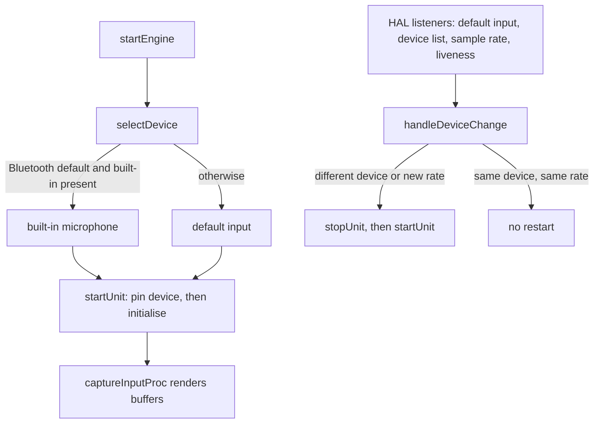

# 0003 — a new capture path, drawn as a diagram

**Claim.** When a change moves structure, here the path audio takes from a device into a recording, the body ends its Summary with one Mermaid diagram labelled with names from the diff. Everything else holds as in 0001: the body comes from the diff, Testing lists only what a reviewer can check, Impact names what the reviewer must weigh, and the body carries no provenance. A warned line stops the PR until it is rewritten.

**Input.** The same macOS app as 0001. Five commits, twenty files, 542 insertions and 177 deletions: microphone capture moves from `AVAudioEngine` to a HAL output unit pinned to one chosen input device, with two new source files, a rewritten `MicrophoneCapability.swift`, three other sources, three test files, the changelog, `AGENTS.md`, and nine docs. With a Bluetooth headset as the default input, River now records from the built-in microphone, so the headset stays out of call mode.

## bare

Read the repo's `docs/conventions/git.md`, `git diff --stat`, and the five commit messages; never read the diff. Its first `cat > /tmp/pr76.md` needed approval outside the clone and was refused, so it passed the body inline. Pushed with `git push -u`, then `gh pr create`. 7 turns, 27.1 s, $0.115.

**Title:** `feat(audio): capture through a HAL unit pinned to the chosen device`

```markdown
## Summary
Microphone capture moves from `AVAudioEngine` to a HAL output unit pinned to one chosen input device, so a Bluetooth headset no longer drops into call mode when recording starts.

## Scope
- `MicrophoneCapability`, plus new `CoreAudioDevices` and `InputDeviceSelection` in `Sources/River/Architecture/`
- `AudioCaptureManager`, `Constants`, `AppState`
- Tests: capability, device selection, render buffer, capture manager
- Docs: capability/permissions/pipeline docs, ADR 0001, plan 0032, logging and tests conventions, AGENTS.md rule 3, CHANGELOG

## Changes Made
- `MicrophoneCapability` opens a HAL output unit pinned to one device before it initialises. `AudioOutputUnitStart` replaces `AVAudioEngine`, and it is still called in only that one place.
- `InputDeviceSelection` picks the built-in microphone (preferring the `BuiltInMicrophoneDevice` UID) when the default input is Bluetooth.
- HAL listeners for the default input and the device list replace the configuration-change notification. The unit restarts only on a new device, or on the same device at a new nominal rate.
- `renderBuffer` sets `frameLength` before `AudioUnitRender`. Without it every render failed with paramErr and recordings came back empty.
- The render callback logs its first failure per unit. Listener removal logs a non-zero status, and device names log as private.
- Docs and wording no longer refer to an audio engine.

## Impact
- The capture path changes for all users. The permission gate and the single `AudioOutputUnitStart` call site are unchanged.
- Bluetooth default inputs now record from the built-in mic, so the headset stays in high-quality output mode.
- Rule 3 and the audio docs are updated in the same change.

## Testing
- [ ] `swift build`
- [ ] `swift test`
- [ ] On device: record with the built-in mic as default input
- [ ] On device: record with a Bluetooth headset as default input (no call-mode switch, non-empty transcript)
- [ ] On device: change the default input and the device sample rate mid-session

🤖 Generated with [Claude Code](https://claude.com/claude-code)
```

## skill

Preflight, then the merge-base diff in three calls by path, as the preflight's "read path by path" note asks for a diff over 500 lines. Then the body written to a `mktemp` file and linted three times: the first two exited 2, and the third passed. Then `git push -u` and `gh pr create --body-file`. 9 turns, 36.8 s, $0.198.

**Title:** `feat(audio): capture through a HAL unit pinned to the chosen device`

````markdown
## Summary

`MicrophoneCapability` captures through a HAL output unit pinned to a chosen device, replacing `AVAudioEngine`. With a Bluetooth headset as the default input, River records from the built-in microphone, so the headset stays out of call mode.



## Changes

- `MicrophoneCapability` replaces `AVAudioEngine` with a HAL output unit. The unit enables input, disables output, pins the device, sets the client format, then initialises.
- `MicrophoneCapability.handleDeviceChange` replaces the `AVAudioEngineConfigurationChange` handler. HAL listeners on the default input, the device list, and the pinned device's sample rate and liveness trigger it. It restarts the unit only for a different device or a new rate.
- `captureInputProc` and `CaptureSink` pull audio on the HAL IO thread. They compute RMS there and hop to the main actor. The first render failure is logged once per unit.
- `MicrophoneCapability.renderBuffer` sets `frameLength` before `AudioUnitRender`. A fresh buffer has length 0, so the render failed with -50.
- `InputDeviceSelection` (new) holds the pure rule: a Bluetooth default input maps to the built-in microphone when one exists.
- `CoreAudioDevices` (new) reads the default input, the built-in input, Bluetooth transport, device names, and nominal sample rates.
- `AudioCaptureManager` and `Constants` update comments and one user-facing message to say "capture unit" instead of "engine".
- `AGENTS.md` rule 3 and `docs/` name `AudioOutputUnitStart` as the gated call in place of `AVAudioEngine.start()`. `CHANGELOG.md` records the Bluetooth behavior.
- `InputDeviceSelectionTests` (new), `CapabilityTests` and `AudioCaptureManagerTests` cover the selection rule, the device-change handler, and the render buffer size.

## Impact

- With a Bluetooth headset as the default input, recordings come from the Mac's built-in microphone. A Mac without a built-in microphone keeps the headset.
- Recordings run at the chosen device's sample rate. `AudioCaptureManager` already converts each run of same-format buffers.
- The start-up delay of the HAL unit is not yet measured. The 60-100 ms figure behind the `stopRecording` wait and the capture gap watchdog comes from `AVAudioEngine`.
- A missing Microphone grant no longer fails the start. CoreAudio delivers silence, which the silence trim reads as "nothing was said". `status` still reports `.denied` to onboarding.

## Testing

For the reviewer:
- [ ] `swift test` passes, including `InputDeviceSelectionTests`, `CapabilityTests` and `AudioCaptureManagerTests`
- [ ] With AirPods connected as the default input, a dictation records from the built-in microphone and the AirPods stay in A2DP quality (no drop in music playback)
- [ ] When the pinned microphone is unplugged mid-recording, capture moves to another device and the recording continues; `log stream` shows "moving capture to"
- [ ] A sample rate change in Audio MIDI Setup mid-recording restarts the unit at the new rate
- [ ] A first short tap-and-release still transcribes, given the unmeasured HAL start-up delay
````

The two warned lints, as printed:

```
LINT WARN: bullet opens with an -ing word — write the action or the result: 42:- [ ] Disconnecting the pinned microphone mid-recording moves capture to another device …
LINT WARN: bullet opens with an -ing word — write the action or the result: 42:- [ ] Unplugging the pinned microphone mid-recording moves capture to another device …
```

## Observations

- Same title from both arms, the lead commit's subject.
- Bare never opened the diff. Its bullets restate the five commit messages. The skill read the diff in three calls by path and named, per file, what each piece does, down to the `-50` render error and the listener on device liveness.
- The skill drew the diagram the rule asks for: one flowchart with ten nodes, labelled with names from the diff (`startEngine`, `selectDevice`, `handleDeviceChange`), drawn as the flow after the change. It puts two flows in one chart, startup and device change, and the second has no edge into the first. A reviewer still gets both paths without reading `MicrophoneCapability.swift`. Whether GitHub renders it was not checked by the run; open the PR to see.
- Two of the skill's Impact bullets carry facts only the diff holds, and both trace to comments in it: the HAL start-up delay is unmeasured, with the 60-100 ms figure measured under `AVAudioEngine`, and a missing Microphone grant now gives silence instead of a failed start. Bare's Impact has neither.
- The lint gate stopped the body twice. The skill replaced "Disconnecting" with "Unplugging", another -ing word, and only on the second warning rewrote both flagged bullets as clauses. The lint names only the first hit of each kind, so the second bullet ("Setting a new sample rate") stayed hidden until the first was fixed.
- Bare followed the repo's own skeleton, `## Scope` and `## Changes Made` included, from `docs/conventions/git.md`. The skill used its own shape and has no Scope section, as `SKILL.md` asks.
- Bare ended with the footer the harness asks for. The skill's body has none.
- Both pushed with a plain `git push -u` and opened against `base/76`, not as a draft.
- The skill cost $0.198 against bare's $0.115, and took 37 s against 27 s. The diff is the largest of these cases, about 720 changed lines.
