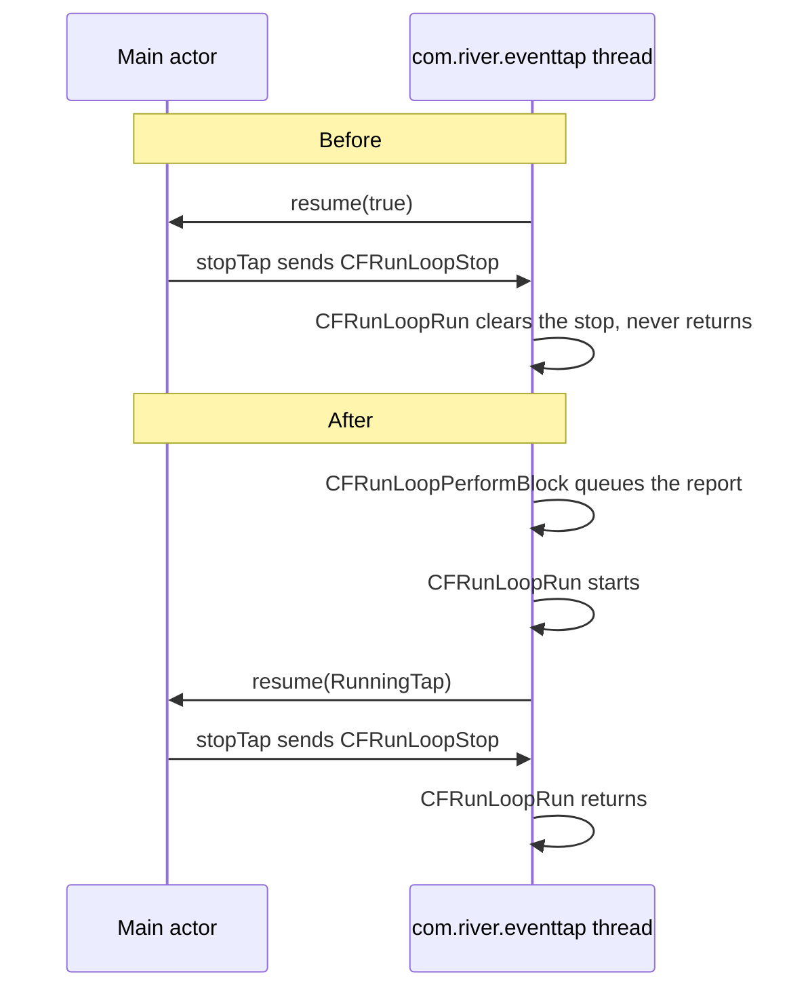

# 0004 — a start race, drawn as a sequence

**Claim.** A diagram is not only for a large change. When a small change alters the order of calls across threads, and the bug is the difference between two orders, the body draws both: the order that raced and the order that does not.

**Input.** The same macOS app as 0001. One commit, three files, 60 insertions and 11 deletions: `InputMonitoringCapability.startTap` reported the event tap started before its run loop ran, so a `CFRunLoopStop` from a quick `stopTap` could land before `CFRunLoopRun` began, be lost, and leave `stopTap` waiting for the tap thread forever. The fix reports the start from a block queued inside the running loop, adds a lifecycle test, and records the rule in a threading doc.

## bare

Read the repo's `docs/conventions/git.md`, the commit message, and the full diff. Pushed with `git push -u`, then `gh pr create` with the body inline. 5 turns, 18.9 s, $0.096.

**Title:** `fix(hotkey): report the event tap started only once its run loop runs`

```markdown
## Summary
`startTap` reported the tap as started before its run loop was running, so a quick `stopTap` could be lost and wait on the tap thread forever. It now reports from inside the running loop.

## Scope
- `Sources/River/Architecture/InputMonitoringCapability.swift`
- `Tests/RiverTests/CapabilityTests.swift`
- `docs/architecture/threading-invariant.md`

## Changes Made
- Report the start from a block queued with `CFRunLoopPerformBlock`, which runs inside `CFRunLoopRun`, instead of resuming before it.
- Hand the tap and run loop back through that same report (a `RunningTap` value), replacing the separate main-actor hop that a stop could beat.
- Add a lifecycle test that starts and stops 300 times, with a 2 s deadline per stop so a regression fails instead of hanging.
- Record the rule and its reason in `threading-invariant.md`.

## Impact
No behavior change when the stop comes late. A stop right after a start now always ends the tap thread. The event tap still runs on the dedicated `com.river.eventtap` thread (architecture rule 1).

## Testing
- [ ] `swift build`
- [ ] `swift test` — the new test only exercises the real tap where the test process has Input Monitoring (a developer terminal). Without it, `tapCreate` returns nil and the test passes trivially, as in CI.

🤖 Generated with [Claude Code](https://claude.com/claude-code)
```

## skill

Preflight, then the merge-base diff, then one call that wrote the body and the title to `mktemp` files and ran the `ship:` command. The lint passed first time, the gate pushed and opened the PR, and the output ended `SHIPPED: opened a PR against base/80`. 4 turns, 20.4 s, $0.105.

**Title:** `fix(hotkey): report the event tap started only once its run loop runs`

````markdown
## Summary

`startTap` reported the tap started before its run loop ran, so a quick `stopTap` sent `CFRunLoopStop` too early, the stop was lost, and `stopTap` waited on the thread forever (a hung local test run on 2026-10-27). `startTap` now reports started from a block queued with `CFRunLoopPerformBlock`, which runs inside the loop, and hands the tap and run loop back through that same report.



## Changes

- `InputMonitoringCapability.startTap` resumes from inside the running loop with a `RunningTap` value instead of `Bool`.
- `startTap` assigns `tap` and `tapRunLoop` before it returns, replacing the separate main-actor hop a stop could beat.
- `RunningTap` carries the tap and run loop from the tap thread to the main actor.
- `InputMonitoringLifecycleTests` starts and stops the capability 300 times, with a 2 s deadline per stop.
- `docs/architecture/threading-invariant.md` records the rule and its reason.

## Impact

`startTap` returns slightly later, once the run loop is running. The event tap stays on the `com.river.eventtap` thread, so rule 1 holds.

## Testing

Verified:
- None run in this session.

For the reviewer:
- [ ] Run `swift test --filter InputMonitoringLifecycleTests` from a terminal with Input Monitoring granted. Without it `tapCreate` returns nil and the test passes trivially.
- [ ] Run `swift test` and confirm the session tests that start and stop back to back no longer hang.
````

## Observations

- Same title from both arms, the commit's subject.
- Both arms read the full diff, so this case separates them on the body, not on what they read. The two Changes lists say much the same.
- The diagram draws both orders in one sequence, split by `Before` and `After` notes, so the reviewer sees the stop that was lost as well as the stop that now lands. Eight messages, inside `## Summary`, a `sequenceDiagram`: the lint's shape checks passed.
- Both Summaries open with the problem in the past tense. The skill's adds the trigger from the diff's comments, a hung local test run on 2026-10-27.
- The skill's Impact names what a reviewer gives up and what still holds: `startTap` returns slightly later, once the run loop runs, and the event tap stays on its own thread, so the threading rule holds. Bare's Impact says what does not change.
- Both arms put the same caveat in Testing: the new test passes trivially where the process lacks Input Monitoring.
- The skill's Testing opens with `Verified:` and one bullet, "None run in this session." `SKILL.md` says to leave the label out when nothing ran, so the label promises evidence the section does not hold. No earlier run did this, and the lint does not check it.
- Bare followed the repo's skeleton with its Scope section, and ended with the harness footer. The skill's body has neither.
- The skill never ran `git push` or `gh` itself. One `--ship` call linted, pushed, and opened the PR.
- The skill cost $0.105 against bare's $0.096, and took 20 s against 19 s.
