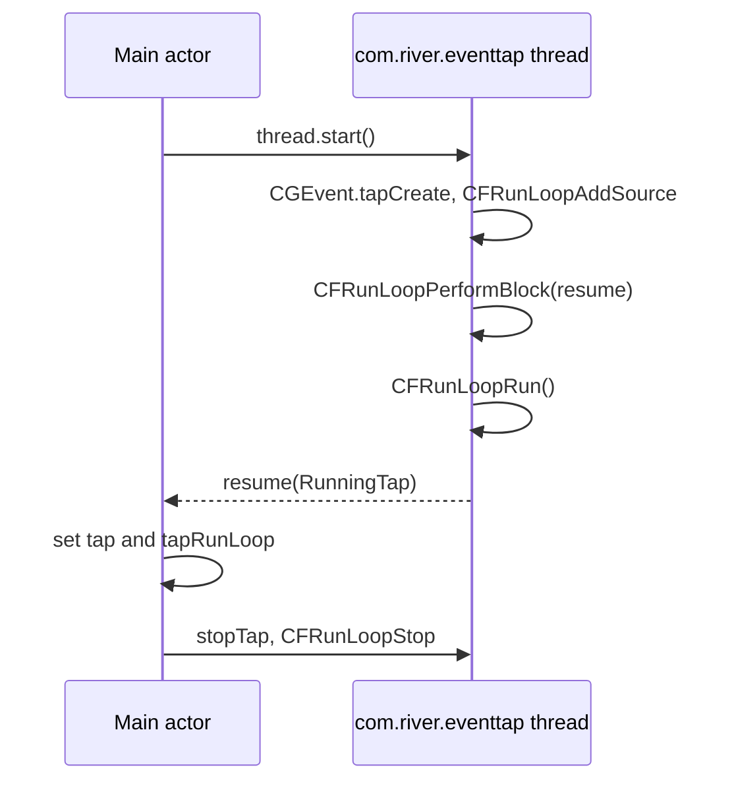

# 0004 — a start race, drawn as a sequence

**Claim.** A diagram is not only for a large change. When a small change alters the order of calls across threads, the body draws that order as one sequence diagram, labelled with names from the diff.

**Input.** The same macOS app as 0001. One commit, three files, 60 insertions and 11 deletions: `InputMonitoringCapability.startTap` reported the event tap started before its run loop ran, so a `CFRunLoopStop` from a quick `stopTap` could land before `CFRunLoopRun` began, be lost, and leave `stopTap` waiting for the tap thread forever. The fix reports the start from a block queued inside the running loop, adds a lifecycle test, and records the rule in a threading doc.

## bare

Read the repo's `docs/conventions/git.md`, the commit message, and the full diff. Pushed with `git push -u`, then `gh pr create` with the body inline. 5 turns, 18.9 s, $0.096.

**Title:** `fix(hotkey): report the event tap started only once its run loop runs`

```markdown
## Summary
`startTap` reported the tap as started before its run loop was running, so a quick `stopTap` could be lost and wait on the tap thread forever. It now reports from inside the running loop.

## Scope
- `Sources/River/Architecture/InputMonitoringCapability.swift`
- `Tests/RiverTests/CapabilityTests.swift`
- `docs/architecture/threading-invariant.md`

## Changes Made
- Report the start from a block queued with `CFRunLoopPerformBlock`, which runs inside `CFRunLoopRun`, instead of resuming before it.
- Hand the tap and run loop back through that same report (a `RunningTap` value), replacing the separate main-actor hop that a stop could beat.
- Add a lifecycle test that starts and stops 300 times, with a 2 s deadline per stop so a regression fails instead of hanging.
- Record the rule and its reason in `threading-invariant.md`.

## Impact
No behavior change when the stop comes late. A stop right after a start now always ends the tap thread. The event tap still runs on the dedicated `com.river.eventtap` thread (architecture rule 1).

## Testing
- [ ] `swift build`
- [ ] `swift test` — the new test only exercises the real tap where the test process has Input Monitoring (a developer terminal). Without it, `tapCreate` returns nil and the test passes trivially, as in CI.

🤖 Generated with [Claude Code](https://claude.com/claude-code)
```

## skill

Preflight, then the merge-base diff, then the body written to a `mktemp` file and linted; the lint passed first time. Then `git push -u` and `gh pr create --body-file`. 5 turns, 24.4 s, $0.109.

**Title:** `fix(hotkey): report the event tap started only once its run loop runs`

````markdown
## Summary

`InputMonitoringCapability.startTap` now reports the tap started only once its run loop is running, so a `stopTap` that follows a start can no longer hang.



## Changes

- `InputMonitoringCapability.startTap` queues the `resume` call with `CFRunLoopPerformBlock`, so it fires from inside `CFRunLoopRun`.
- `startTap` hands the tap and run loop back through the continuation as a new `RunningTap` value, and assigns `tap` and `tapRunLoop` before it returns. This replaces the separate `Task { @MainActor }` hop that a stop could beat.
- `InputMonitoringLifecycleTests` in `CapabilityTests.swift` starts and stops the tap 300 times, with a 2 s deadline on each stop.
- `docs/architecture/threading-invariant.md` records the rule and the reason for it.

## Impact

A `CFRunLoopStop` sent before `CFRunLoopRun` begins is lost. `stopTap` then waited on the thread forever, which hung a local test run on 2026-10-27. The tap thread, its QoS, and the `.listenOnly` mode do not change.

## Testing

For the reviewer:
- [ ] Run `swift test --filter InputMonitoringLifecycleTests` in a terminal that has Input Monitoring; the test finishes with no stop timeout.
- [ ] Run `swift test`; the full suite finishes without hanging.
- [ ] Confirm the new test only passes trivially where Input Monitoring is missing (`tapCreate` returns nil), as the test comment states.
- [ ] Press the hotkey after launching the built app; the event tap still fires.
````

## Observations

- Same title from both arms, the commit's subject.
- Both arms read the full diff, so this case separates them on the body's shape, not on what they read. The two Changes lists say much the same.
- The skill drew a sequence diagram of the two threads, with participants and calls named as in the diff (`com.river.eventtap`, `CFRunLoopPerformBlock`, `RunningTap`). It shows the order after the fix only. The bug is the difference between two orders, a stop that lands before `CFRunLoopRun`, and `SKILL.md` asks for before and after when the change is the difference, so the diagram shows the fix without the race it closes.
- The skill's Impact gives the trigger with its date, a hung local test run on 2026-10-27, from a comment in the diff and the threading doc. Bare's Impact says what does not change.
- Both arms put the same caveat in Testing: the new test passes trivially where the process lacks Input Monitoring. Bare attached it to a `swift test` box; the skill made it a reviewer item of its own and added a check in the built app.
- Bare followed the repo's skeleton with its Scope section, and ended with the harness footer. The skill's body has neither.
- The skill's push printed two remote errors about writing a pack file while the six arms pushed to the fixture at once; the push still created the branch, and the skill's summary reported the errors and asked for the Files tab to be checked. The PR holds the full commit and diff.
- The skill cost $0.109 against bare's $0.096, and took 24 s against 19 s.
