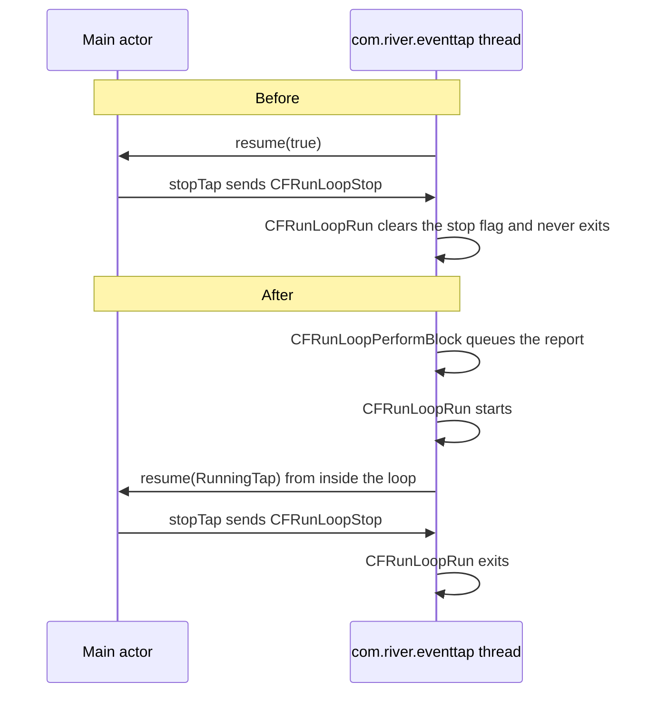

# 0004 — a start race, drawn as a sequence

**Claim.** A diagram is not only for a large change. When a small change alters the order of calls across threads, and the bug is the difference between two orders, the body draws both: the order that raced and the order that does not.

**Input.** The same macOS app as 0001. One commit, three files, 60 insertions and 11 deletions: `InputMonitoringCapability.startTap` reported the event tap started before its run loop ran, so a `CFRunLoopStop` from a quick `stopTap` could land before `CFRunLoopRun` began, be lost, and leave `stopTap` waiting for the tap thread forever. The fix reports the start from a block queued inside the running loop, adds a lifecycle test, and records the rule in a threading doc.

## bare

Read the repo's `docs/conventions/git.md`, the commit message, and the full diff. Pushed with `git push -u`, then `gh pr create` with the body inline. 5 turns, 18.9 s, $0.096.

**Title:** `fix(hotkey): report the event tap started only once its run loop runs`

```markdown
## Summary
`startTap` reported the tap as started before its run loop was running, so a quick `stopTap` could be lost and wait on the tap thread forever. It now reports from inside the running loop.

## Scope
- `Sources/River/Architecture/InputMonitoringCapability.swift`
- `Tests/RiverTests/CapabilityTests.swift`
- `docs/architecture/threading-invariant.md`

## Changes Made
- Report the start from a block queued with `CFRunLoopPerformBlock`, which runs inside `CFRunLoopRun`, instead of resuming before it.
- Hand the tap and run loop back through that same report (a `RunningTap` value), replacing the separate main-actor hop that a stop could beat.
- Add a lifecycle test that starts and stops 300 times, with a 2 s deadline per stop so a regression fails instead of hanging.
- Record the rule and its reason in `threading-invariant.md`.

## Impact
No behavior change when the stop comes late. A stop right after a start now always ends the tap thread. The event tap still runs on the dedicated `com.river.eventtap` thread (architecture rule 1).

## Testing
- [ ] `swift build`
- [ ] `swift test` — the new test only exercises the real tap where the test process has Input Monitoring (a developer terminal). Without it, `tapCreate` returns nil and the test passes trivially, as in CI.

🤖 Generated with [Claude Code](https://claude.com/claude-code)
```

## skill

Preflight, then the merge-base diff, then one call that wrote the body to a `mktemp` file and ran the `ship:` command. The lint passed first time, the gate pushed and opened the PR, and the output ended `SHIPPED: opened a PR against base/80`. 4 turns, 29.2 s, $0.105.

**Title:** `fix(hotkey): report the event tap started only once its run loop runs`

````markdown
## Summary

`startTap` reported the tap started before its run loop ran, so a quick `stopTap` sent `CFRunLoopStop` too early, lost it, and waited on the thread forever. This hung a local test run on 2026-10-27. `startTap` now reports the tap started from a block queued on the run loop, so the loop is running by the time `startTap` returns.



## Changes

- `InputMonitoringCapability.startTap` resumes its continuation from a `CFRunLoopPerformBlock` block, not before `CFRunLoopRun`.
- `InputMonitoringCapability.startTap` receives the tap and run loop through the continuation as a `RunningTap` and assigns `tap` and `tapRunLoop` before it returns, replacing the separate main-actor hop.
- `RunningTap` is a new private `@unchecked Sendable` struct that carries the `CFMachPort` and `CFRunLoop` to the main actor.
- `InputMonitoringLifecycleTests` in `CapabilityTests.swift` starts and stops the capability 300 times, with a 2 s deadline per stop.
- `docs/architecture/threading-invariant.md` records the rule and the reason.

## Impact

The `RunningTap` struct is `@unchecked Sendable`. The main actor only calls `CGEvent.tapEnable` and `CFRunLoopStop` on its fields, and the run loop itself stays on the event tap thread, so the thread invariant holds.

## Testing

For the reviewer:
- [ ] Run `swift test --filter InputMonitoringLifecycleTests` from a terminal with Input Monitoring granted and confirm it finishes without hanging; without the grant `tapCreate` returns nil and the test passes trivially
- [ ] Revert the `startTap` change locally, rerun the same test, and confirm it fails at the 2 s deadline
- [ ] Run `swift test` and confirm the session tests that start and stop the tap back to back no longer hang
````

## Observations

- Same title from both arms, the commit's subject.
- Both arms read the full diff, so this case separates them on the body, not on what they read. The two Changes lists say much the same.
- The diagram draws both orders in one sequence, split by `Before` and `After` notes, so the reviewer sees the stop that was lost as well as the stop that now lands. Eight messages, inside `## Summary`, a `sequenceDiagram`: the lint's shape checks passed.
- Both Summaries open with the problem in the past tense. The skill's adds the trigger from the diff's comments, a hung local test run on 2026-10-27.
- The skill's Impact names a reviewer's real question, why an `@unchecked Sendable` is safe here, and answers it from a comment in the diff. Bare's Impact says what does not change.
- Both arms put the same caveat in Testing: the new test passes trivially where the process lacks Input Monitoring. The skill adds a check that the test can fail: revert the fix and confirm the test hits its 2 s deadline.
- Bare followed the repo's skeleton with its Scope section, and ended with the harness footer. The skill's body has neither.
- The skill never ran `git push` or `gh` itself. One `--ship` call linted, pushed, and opened the PR.
- The skill cost $0.105 against bare's $0.096, and took 29 s against 19 s.
