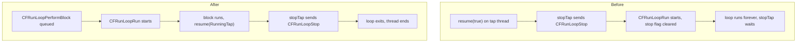

# 0004 — a start race, drawn as a sequence

**Claim.** A diagram is not only for a large change. When a small change alters the order of calls across threads, and the bug is the difference between two orders, the body draws both: the order that raced and the order that does not.

**Input.** The same macOS app as 0001. One commit, three files, 60 insertions and 11 deletions: `InputMonitoringCapability.startTap` reported the event tap started before its run loop ran, so a `CFRunLoopStop` from a quick `stopTap` could land before `CFRunLoopRun` began, be lost, and leave `stopTap` waiting for the tap thread forever. The fix reports the start from a block queued inside the running loop, adds a lifecycle test, and records the rule in a threading doc.

## bare

Read the repo's `docs/conventions/git.md`, the commit message, and the full diff. Pushed with `git push -u`, then `gh pr create` with the body inline. 5 turns, 18.9 s, $0.096.

**Title:** `fix(hotkey): report the event tap started only once its run loop runs`

```markdown
## Summary
`startTap` reported the tap as started before its run loop was running, so a quick `stopTap` could be lost and wait on the tap thread forever. It now reports from inside the running loop.

## Scope
- `Sources/River/Architecture/InputMonitoringCapability.swift`
- `Tests/RiverTests/CapabilityTests.swift`
- `docs/architecture/threading-invariant.md`

## Changes Made
- Report the start from a block queued with `CFRunLoopPerformBlock`, which runs inside `CFRunLoopRun`, instead of resuming before it.
- Hand the tap and run loop back through that same report (a `RunningTap` value), replacing the separate main-actor hop that a stop could beat.
- Add a lifecycle test that starts and stops 300 times, with a 2 s deadline per stop so a regression fails instead of hanging.
- Record the rule and its reason in `threading-invariant.md`.

## Impact
No behavior change when the stop comes late. A stop right after a start now always ends the tap thread. The event tap still runs on the dedicated `com.river.eventtap` thread (architecture rule 1).

## Testing
- [ ] `swift build`
- [ ] `swift test` — the new test only exercises the real tap where the test process has Input Monitoring (a developer terminal). Without it, `tapCreate` returns nil and the test passes trivially, as in CI.

🤖 Generated with [Claude Code](https://claude.com/claude-code)
```

## skill

Preflight, then the merge-base diff, then one call that wrote the body and the title to `mktemp` files and ran the `ship:` command. The lint passed first time, the gate pushed and opened the PR, and the output ended `SHIPPED: opened a PR against base/80`. 4 turns, 23.2 s, $0.109.

**Title:** `fix(hotkey): report the event tap started only once its run loop runs`

````markdown
## Summary

`startTap` reported the tap started before its run loop ran, so a quick `stopTap` could send `CFRunLoopStop` too early, lose it, and wait on the tap thread forever. A local test run hung this way on 2026-10-27. `startTap` now reports started from a block queued on the run loop, so the report arrives only once the loop runs, and it hands back the tap and run loop through that same report.



## Changes

- `InputMonitoringCapability.startTap` resumes its continuation from a `CFRunLoopPerformBlock` block, which runs inside the loop.
- `startTap` returns the tap and run loop in a new private `RunningTap` value and assigns `tap` and `tapRunLoop` before it returns. This replaces the separate main-actor hop that a stop could beat.
- `InputMonitoringLifecycleTests` in `CapabilityTests.swift` starts and stops the tap 300 times back to back, with a 2 s deadline on each `stopTap`, so a regression fails instead of hanging.
- `docs/architecture/threading-invariant.md` records the rule and the reason.

## Impact

The event tap thread invariant stays as is: the tap still runs on `com.river.eventtap` at `.userInteractive`. The new test needs Input Monitoring on the test process. Without it, `tapCreate` returns nil and the test passes trivially, as it does in CI.

## Testing

For the reviewer:
- [ ] Run `swift test --filter InputMonitoringLifecycleTests` from a terminal that has Input Monitoring and confirm all 300 iterations pass
- [ ] Run `swift test` and confirm the session tests that start and stop back to back no longer hang
- [ ] Read `RunningTap` in `InputMonitoringCapability.swift` and confirm `CGEvent.tapEnable` and `CFRunLoopStop` are safe to call from the main actor
````

## Observations

- Same title from both arms, the commit's subject.
- Both arms read the full diff, so this case separates them on the body, not on what they read. The two Changes lists say much the same.
- The diagram draws both orders, as two subgraphs of one flowchart, `Before` and `After`, so the reviewer sees the stop that was lost as well as the stop that now lands. Nine nodes, inside `## Summary`: the lint's shape checks passed. The skill's runs before drew the same two orders as one sequence; `SKILL.md` allows either.
- Both Summaries open with the problem in the past tense. The skill's adds the trigger from the diff's comments, a hung local test run on 2026-10-27.
- The skill's Impact says what still holds, the tap's thread and priority, and what the new test needs to mean anything: Input Monitoring on the test process, without which it passes trivially, as it does in CI. Bare's Impact says what does not change.
- The skill's Testing is three reviewer items with no `Verified:` label, since nothing ran; its last item asks the reviewer to confirm that `RunningTap`'s two calls are safe from the main actor. The batch before labelled a `Verified:` that held only "None run in this session."; the lint now fails that, and this run did not write one to fail.
- Bare followed the repo's skeleton with its Scope section, and ended with the harness footer. The skill's body has neither.
- The skill never ran `git push` or `gh` itself. One `--ship` call linted, pushed, and opened the PR.
- The skill cost $0.109 against bare's $0.096, and took 23 s against 19 s.
