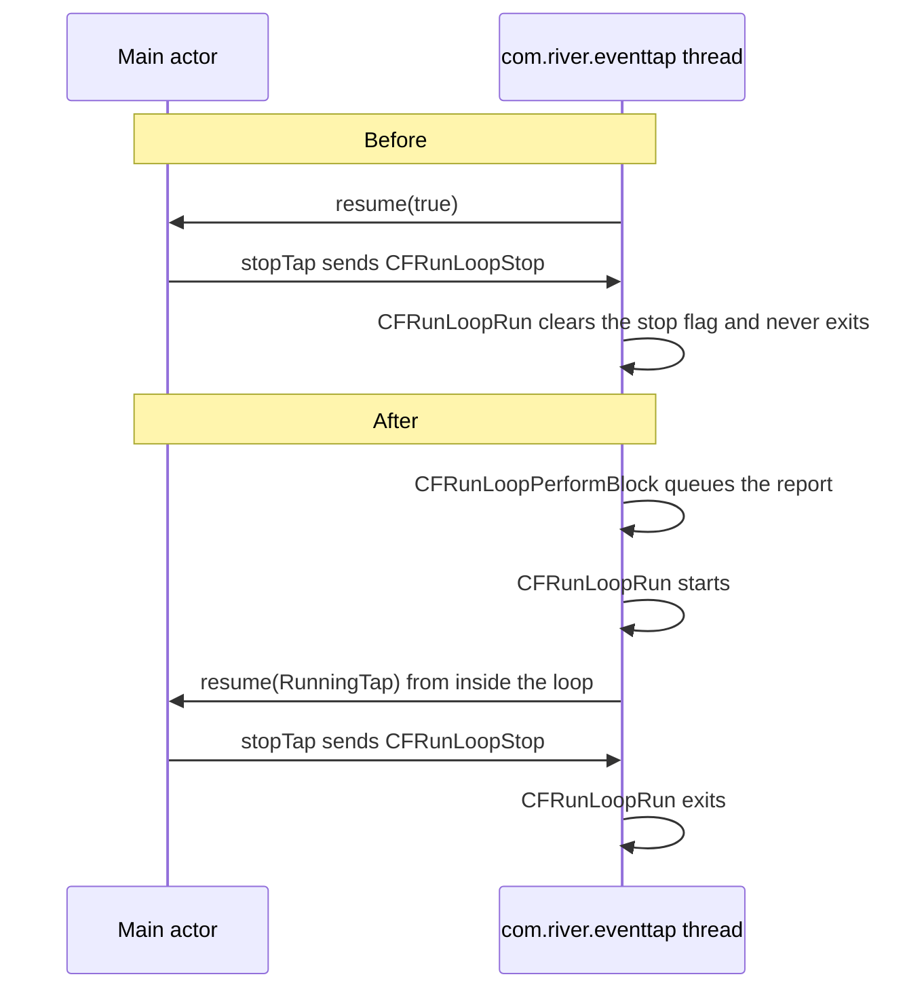

# 0006 — the start race again, after the review

**Claim.** On the change 0004 ran, the skill as it now stands leads its Summary with the problem, draws the order that raced beside the order that does not, and ships through one gate call that lints before it pushes.

**Input.** The same change as 0004: River PR #80, one commit, three files, 60 insertions and 11 deletions, against the same base. Skill arm only; 0004's bare arm is the comparison, and 0004's skill arm shows the skill before the review.

## skill

Preflight, then the merge-base diff, then one call that wrote the body to a `mktemp` file and ran the `ship:` command the preflight printed. The lint passed first time, the gate pushed and opened the PR, and the output ended `SHIPPED: opened a PR against base/80`. 4 turns, 29.2 s, $0.105.

**Title:** `fix(hotkey): report the event tap started only once its run loop runs`

````markdown
## Summary

`startTap` reported the tap started before its run loop ran, so a quick `stopTap` sent `CFRunLoopStop` too early, lost it, and waited on the thread forever. This hung a local test run on 2026-10-27. `startTap` now reports the tap started from a block queued on the run loop, so the loop is running by the time `startTap` returns.



## Changes

- `InputMonitoringCapability.startTap` resumes its continuation from a `CFRunLoopPerformBlock` block, not before `CFRunLoopRun`.
- `InputMonitoringCapability.startTap` receives the tap and run loop through the continuation as a `RunningTap` and assigns `tap` and `tapRunLoop` before it returns, replacing the separate main-actor hop.
- `RunningTap` is a new private `@unchecked Sendable` struct that carries the `CFMachPort` and `CFRunLoop` to the main actor.
- `InputMonitoringLifecycleTests` in `CapabilityTests.swift` starts and stops the capability 300 times, with a 2 s deadline per stop.
- `docs/architecture/threading-invariant.md` records the rule and the reason.

## Impact

The `RunningTap` struct is `@unchecked Sendable`. The main actor only calls `CGEvent.tapEnable` and `CFRunLoopStop` on its fields, and the run loop itself stays on the event tap thread, so the thread invariant holds.

## Testing

For the reviewer:
- [ ] Run `swift test --filter InputMonitoringLifecycleTests` from a terminal with Input Monitoring granted and confirm it finishes without hanging; without the grant `tapCreate` returns nil and the test passes trivially
- [ ] Revert the `startTap` change locally, rerun the same test, and confirm it fails at the 2 s deadline
- [ ] Run `swift test` and confirm the session tests that start and stop the tap back to back no longer hang
````

## Observations

- The Summary now opens with the problem, in the past tense: what `startTap` did, what a quick `stopTap` lost, and the hung test run it caused. Only then does it say what the code does now. 0004's skill summary opened on the fix and left the problem to "can no longer hang"; bare's opened on the problem, as this one does.
- The diagram draws both orders in one sequence, split by `Before` and `After` notes, so the reviewer sees the stop that was lost as well as the stop that now lands. 0004 drew only the order after the fix. Eight messages, inside `## Summary`, a `sequenceDiagram`: the lint's shape checks passed.
- The Impact section names a reviewer's real question, why an `@unchecked Sendable` is safe here, and answers it from a comment in the diff. 0004's Impact gave the trigger, which this run moved into Summary.
- One Testing item is new: revert the fix and confirm the test fails at its deadline, so the reviewer can see the test catch the bug it guards.
- The agent never ran `git push` or `gh` itself. One `--ship` call linted, pushed, and opened the PR, and printed both outputs back.
- 4 turns and $0.105, against 0004's 5 turns and $0.109.
